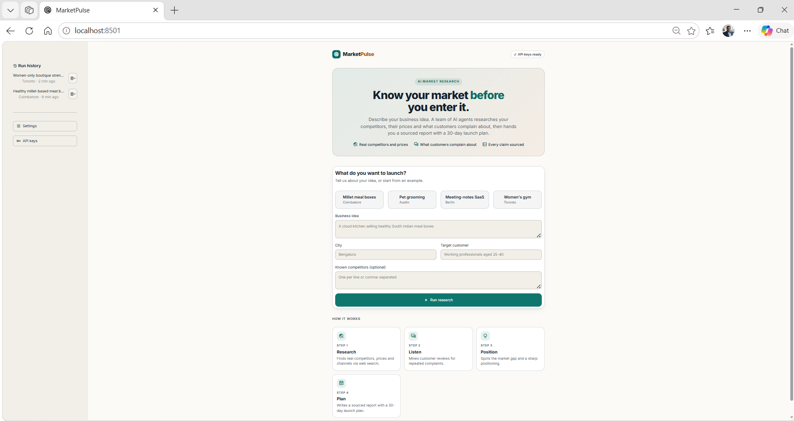
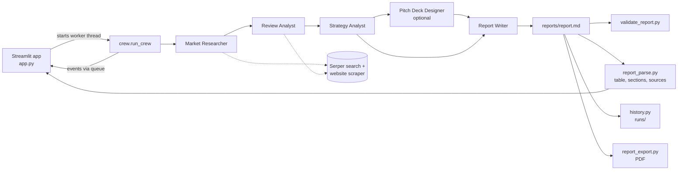

# MarketPulse

> **Know your market before you enter it.**

MarketPulse is a team of AI agents that researches your competitors for a new business idea. Enter an idea, a city and a target customer. It returns a sourced report with competitor prices, customer complaints, the market gap, a recommended positioning and a 30-day launch plan.

## 📌 Overview

A founder planning a new business, such as a healthy meal-box service in a particular city, needs to know who the competitors are, what they charge, what their customers complain about and where the gap is. Done by hand, this means days of searching and copying into spreadsheets.

MarketPulse runs a [CrewAI](https://docs.crewai.com/) crew of role-based agents. Each agent has its own goal and tools and passes its work to the next, so the final report is built from web searches and scraped pages, with source links.

## ✨ Features

**Research crew**
- Crew of 4 agents running 4 tasks in sequence, each task receiving the earlier tasks' output as context
- Optional **Pitch Deck Designer** agent that turns the findings into a 6-slide Markdown deck
- Optional **hierarchical process** where a manager agent coordinates the crew
- Real web access: `SerperDevTool` (search) and `ScrapeWebsiteTool` (read pages) for the researchers, `FileWriterTool` for the writer
- Works for any idea and city; inputs are template variables with nothing hard-coded
- Post-run validation (`validate_report`): problems are shown as a collapsible "Report quality checks" panel and never fail the run

**Streamlit app**
- Landing page with four one-click example ideas, and a form validated with Pydantic (`ScoutInput`)
- Instant feedback on Run: the running screen appears on the next render, and the slow CrewAI import happens in the background thread
- Live running screen: spinner and indeterminate bar, elapsed timer, "last activity" heartbeat, a plain-language line for the active agent, a numbered stepper and a live activity feed that shows searches and page reads
- **Cancel** button: returns to the form immediately and stops the crew at its next LLM call or when the current task finishes (not instantly)
- **Run history**: every finished run is saved under `runs/` and can be reopened or deleted from the sidebar
- Structured results: KPI cards, a sortable competitor table, a price chart, customer-voice and sources tabs, and a pitch-deck tab when enabled
- Report download as Markdown or PDF; pitch deck download as Markdown
- Light and dark colour schemes, responsive down to phone width

## 🎥 Demo



`[ADD DEMO VIDEO HERE]`

## 🏗️ Architecture



| Component | Role |
|---|---|
| `app.py` | Streamlit UI: landing, form, running screen, results, sidebar history |
| `ui_style.py` | CSS and HTML snippets (theme tokens, stepper, feed, KPI cards) |
| `ui_helpers.py` | Streamlit-free logic: key checks, input validation, event formatting, progress labels, worker thread, `CancelToken`, example ideas |
| `crew.py` | `get_llm()`, `build_crew(...)`, `run_crew(...)` |
| `agents.py` | Agent definitions (4 core agents plus the optional pitch-deck agent) |
| `tasks.py` | One task per agent, each with an exact `expected_output` and context wiring |
| `tools.py` | Builds the search, scrape and file-writer tools |
| `schemas.py` | Pydantic models `ScoutInput`, `CrewResult` |
| `report_parse.py` | Parses the report into sections, a competitor table and sources; strips stray code fences |
| `history.py` | Saves, lists, loads and deletes past runs under `runs/` |
| `report_export.py` | `markdown_to_pdf(md)` and `extract_sources(md)` |
| `validate_report.py` | `validate_report(md)` checks a report against the project's done-checklist |

### Agents

| Agent | Responsibility | Tools |
|---|---|---|
| Market Researcher | Finds 3 to 5 real competitors with prices, offers and sales channels | Serper search, website scraper |
| Review Analyst | Finds what customers like and complain about for each competitor | Serper search, website scraper |
| Strategy Analyst | Builds the comparison matrix, finds the market gap, recommends price and positioning | None |
| Report Writer | Writes the final six-section report and saves it to `reports/report.md` | File writer |
| Pitch Deck Designer *(optional)* | Produces a 6-slide deck from the findings | None |

## 🔄 How It Works

1. The user fills in the form (or picks an example). Inputs are validated, and the app checks that both API keys are present.
2. Pressing Run registers the job and shows the running screen straight away. A background thread then imports CrewAI and calls `run_crew`, with inputs applied at kickoff.
3. The Market Researcher finds competitors and prices, and the Review Analyst reads customer feedback for each.
4. The Strategy Analyst builds the comparison, the market gap and the positioning.
5. If enabled, the Pitch Deck Designer drafts the 6-slide deck.
6. The Report Writer composes the report and saves it. The saved file is read back (with the writer's output as the fallback), and any wrapping code fence is removed.
7. `validate_report` checks the report. The app parses it into KPIs, a table and a chart, saves the run to history and shows the results.

Step and task events go from the worker thread to the UI through a `queue.Queue`, and a one-second Streamlit fragment polls it, so no Streamlit call is made from the worker thread.

Process modes: sequential (4 agents / 4 tasks), sequential with pitch deck (5 / 5), or hierarchical with a manager (same tasks, manager-led).

## 🛠️ Tech Stack

| Category | Technology |
|---|---|
| Language | Python 3.11 |
| Agent framework | CrewAI (`crewai`, `crewai-tools`) |
| LLM | OpenAI, model set by `OPENAI_MODEL` (default `gpt-4o-mini`) |
| Web search | Serper.dev via `SerperDevTool` |
| UI | Streamlit |
| Data handling | pandas, Altair (through Streamlit) |
| Validation | Pydantic |
| PDF export | fpdf2 |
| Testing | pytest, Streamlit `AppTest` |

## 📁 Project Structure

```text
marketpulse/
├── app.py
├── ui_style.py
├── ui_helpers.py
├── crew.py
├── agents.py
├── tasks.py
├── tools.py
├── schemas.py
├── report_parse.py
├── history.py
├── report_export.py
├── validate_report.py
├── requirements.txt
├── .env.example
├── .gitignore
├── .streamlit/
│   └── config.toml
├── docs/
│   └── screenshot.png
├── reports/              # latest report.md (git-ignored)
├── runs/                 # saved run history (git-ignored)
└── tests/
    ├── conftest.py
    ├── test_core.py
    ├── test_app_ui.py
    ├── test_history.py
    ├── test_report_parse.py
    └── test_report_export.py
```

## ⚙️ Prerequisites

- Python 3.10 or newer (developed on 3.11)
- An OpenAI API key (paid)
- A Serper.dev API key

## 🚀 Installation

```bash
python -m venv venv
venv\Scripts\activate          # Windows
# source venv/bin/activate     # macOS / Linux

pip install -r requirements.txt
copy .env.example .env         # Windows; use cp on macOS / Linux
```

Then edit `.env` and add your keys.

## 🔐 Configuration

| Variable | Required | Description | Example |
|---|---|---|---|
| `OPENAI_API_KEY` | Yes | Key for LLM calls | `your-key-here` |
| `SERPER_API_KEY` | Yes | Key for web search | `your-serper-key-here` |
| `OPENAI_MODEL` | No | Model name, default `gpt-4o-mini` | `gpt-4o-mini` |

Keys are read only from the environment or `.env`, which is git-ignored. Never commit it.

## ▶️ Running the Application

```bash
streamlit run app.py
```

Streamlit serves the app at `http://localhost:8501` by default. From the parent folder, `streamlit run marketpulse/app.py` also works.

## 💻 Usage

1. Pick an example or enter the business idea, city, target customer and optionally known competitors.
2. Optionally switch on **Hierarchical process** or **Pitch Deck agent** under Settings in the sidebar.
3. Click **Run research** and watch the live screen. Cancel returns you to the form.
4. Read the results in the Report, Competitors, Customer voice and Sources tabs, then download the Markdown or PDF.
5. Past runs appear under Run history in the sidebar.

Sample input:

| Field | Value |
|---|---|
| Business idea | Women-only boutique strength training studio |
| City | Toronto |
| Target customer | Women aged 25-45 new to weightlifting |
| Known competitors | GoodLife Fitness, Anytime Fitness |

### Sample output

Excerpt from a real run of the input above (sequential mode, about 49 seconds, no validation warnings). The text is the model's output from live web research and has not been fact-checked; always verify prices and links yourself.

```markdown
## 1. Key Competitors

| Competitor            | Price (with unit)          | Channel               | Strength                                  | Weakness                              |
|-----------------------|----------------------------|-----------------------|-------------------------------------------|---------------------------------------|
| MOVE Fitness Club     | $49 for 2-week trial       | Website, Social Media | Strong community support, personal coaching | Limited to women only                 |
| Body Positive Fitness | $289/month                 | Website, Social Media | Inclusive environment, body positivity    | Higher price point than some gyms     |
| Elle Fitness          | $19.99/month (after trial) | Website, Social Media | Variety of workout options                | Limited physical locations            |

## 3. Market Gap

... a gap in offering a balanced combination of affordability, personalized
coaching, and a supportive community tailored for women aged 25-45 new to weightlifting.

## 4. Recommended Positioning

"Empowering women to embrace strength training in a supportive, inclusive environment designed for beginners."

## Sources
1. [MOVE Fitness](https://www.movefitnessclub.com/get-started)
2. [Body Positive Fitness](https://bodypositivefitness.ca/)
3. [Elle On Demand](https://www.elleondemand.com/)
```

The full report also contains the sections "What Customers Complain About" and "30-Day Launch Plan".

### Validate a saved report

```bash
python validate_report.py reports/report.md
```

Checks that all six sections exist, the competitor table has at least 3 rows each with a price in the Price column, and Sources contains at least one `http(s)` link. Exit code 0 means pass, 1 means problems were found, and 2 means usage error.

## 🤖 AI / Agent Details

### Implemented

- Role-based agents with distinct goals and backstories, built from templates filled by the user's inputs
- Sequential task pipeline with explicit `context` between tasks, and a fixed `expected_output` format per task
- Optional hierarchical process using CrewAI's manager (`manager_llm` is the same OpenAI model)
- Per-agent step callbacks that report the agent's role to the UI
- Cooperative cancellation: the LLM call and the task callback check a `CancelToken`; the crew stops at the next LLM call or task end

### Verified and not verified

- Sequential mode has been run end to end against live OpenAI and Serper (the two runs shown in Run history).
- Hierarchical mode, the pitch-deck agent and a real cancel mid-run have not been verified live. Cancellation was tested only with a fake LLM.
- The model sometimes wraps the whole report in a ` ```markdown ` fence. The app removes it when reading the report back.

## 🧪 Testing

```bash
python -m pytest marketpulse/tests -q
```

Run this from the parent folder of `marketpulse/`. The tests run offline with dummy keys and cover input validation, crew construction (4/4, 5/5, hierarchical), missing-key errors, per-agent step callbacks, cancellation, progress labels, report parsing and validation, run history (including path traversal), PDF export, and the Streamlit UI through `AppTest`. They do not call any LLM or search service, and they redirect the reports folder so a test never overwrites your real `reports/report.md`.

## 🔒 Security

- API keys come from `.env` / the environment and are not hard-coded; `.env` is in `.gitignore`.
- Inputs are validated before the crew starts (idea, city and target customer must be non-empty).
- Run IDs are matched against a strict pattern and resolved paths are checked, so history cannot read or delete files outside `runs/`.
- The agents read web pages through the scraper tool, and page content flows into the LLM prompts. Prompt-injection protection is not implemented.

## ⚠️ Limitations

- Report quality depends on search results and the chosen LLM. Prices, competitor details and links can be wrong or out of date, so verify them before relying on them.
- Requires paid OpenAI and Serper access, and each run makes many API calls.
- Cancel is cooperative: an LLM or tool call already in progress finishes first. Refreshing or closing the browser tab does not cancel a running crew, and it keeps making paid API calls until it finishes.
- In hierarchical mode, the progress display shows a task count and the last worker role seen, not an exact step.
- The PDF is plain text and tables, with unsupported characters replaced (for example the rupee sign becomes "Rs").
- The history list and the latest `reports/report.md` are stored locally and are not shared between machines.

## 🗺️ Roadmap

- [ ] Live verification of hierarchical mode, the pitch-deck agent and cancel
- [ ] Per-run report file names to support concurrent runs
- [ ] Re-run weekly and highlight price changes
- [ ] Demo video

## 🐛 Troubleshooting

### The Run button is disabled

**Solution:** The sidebar warns which key is missing. Set `OPENAI_API_KEY` and `SERPER_API_KEY` in `.env` and restart the app.

### The running screen shows "waiting for first update" for a while

**Solution:** This is normal. The first searches and page reads can take a moment, and web research can go quiet for a while. The elapsed timer and heartbeat show the app is still working. Use Cancel if you want to stop.

### `ModuleNotFoundError: No module named 'marketpulse'` in tests

**Solution:** Run pytest from the parent folder of `marketpulse/`, as shown in the Testing section.

## 📄 License

`[ADD LICENSE INFORMATION]`

## 👨‍💻 Author

**Dinesh R**

- LinkedIn: [dinesh-r29997](https://www.linkedin.com/in/dinesh-r29997/)
- Repository: [dineshpec/MarketPulse](https://github.com/dineshpec/MarketPulse)
